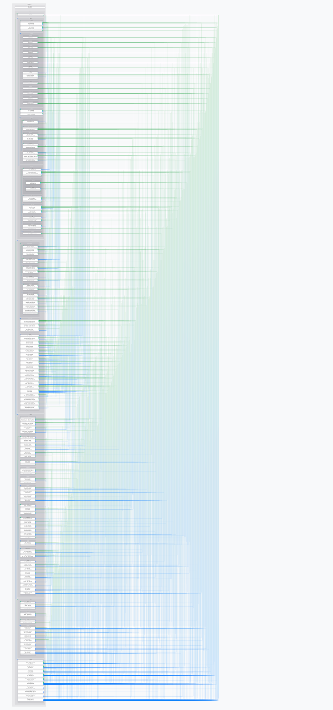

# fMoney

fMoney is a free, open-source personal finance app from the MoneyTools vTeam. It is the Flutter edition of [MyMoney.Net](https://github.com/MoneyTools/MyMoney.Net) and opens the same `.mmdb` files.

It runs on macOS, Windows and Linux, and in a web browser. Your data stays in a file on your own computer.

- Desktop downloads: <https://github.com/vteam-com/fMoney/releases/latest>
- Web version: <https://money.vteam.com>
- Source: <https://github.com/vteam-com/fMoney>


## Features

- Accounts, transactions, splits, transfers and reconciliation
- Categories, payees, and aliases that rename payees by pattern
- Cash flow, investments, stocks, rentals and events
- Import from QFX/OFX, QIF, CSV, Excel (XLSX) and PDF bank statements
- An optional AI assistant that runs on your machine with [Ollama](https://ollama.com)
- English, French and Spanish

## Try it in your browser

Open <https://money.vteam.com> and click **Use Demo Data**. Nothing to install.

## Install the desktop app

Download the file for your computer from the [latest release](https://github.com/vteam-com/fMoney/releases/latest):

| Platform | File                       | Requires                              |
| -------- | -------------------------- | ------------------------------------- |
| macOS    | `mymoney-app-macos.zip`    | macOS 12 or later, Apple silicon or Intel |
| Windows  | `mymoney-app-windows.zip`  | Windows 10 or later, 64-bit           |
| Linux    | `mymoney-app-linux.tar.gz` | 64-bit (x64) with GTK 3               |

Two things apply to every platform:

- **Install it in a folder you can write to.** fMoney updates itself in place, so it needs to be able to replace its own files.
- **Expect a security warning the first time you open it.** The builds are not signed with an Apple or Microsoft developer certificate. The steps below show how to open it.

### macOS

1. Download `mymoney-app-macos.zip` and double-click it to unzip it (Safari may unzip it for you). You get `money.app`.
2. Drag `money.app` into your **Applications** folder. If your account is not an administrator, use the `Applications` folder in your home folder instead.

   Don't run it from **Downloads**. macOS runs apps there from a read-only copy, and updates can't install.
3. Double-click `money.app`. macOS blocks it the first time because Apple hasn't checked it. To open it:
   1. Open **System Settings › Privacy & Security**.
   2. Scroll down to **Security**, click **Open Anyway** next to the message about `money`, and confirm.

   If macOS says the app "is damaged and can't be opened", remove the download flag in Terminal, then open it again:

   ```bash
   xattr -dr com.apple.quarantine /Applications/money.app
   ```

### Windows

1. Download `mymoney-app-windows.zip`.
2. Right-click it, choose **Extract All…**, and extract it to a folder in your user profile, for example `%LOCALAPPDATA%\fMoney`.

   Don't use `C:\Program Files`: fMoney can't update itself there.
3. Open the folder and run `money.exe`. Leave it next to the files it came with. To launch it from somewhere else, pin it to Start or create a shortcut.
4. If Windows shows **Windows protected your PC**, click **More info**, then **Run anyway**.

If Windows says `VCRUNTIME140_1.dll` or `MSVCP140.dll` was not found, install the [Microsoft Visual C++ Redistributable (x64)](https://aka.ms/vs/17/release/vc_redist.x64.exe) and run `money.exe` again.

### Linux

The archive has no top-level folder, so extract it into a folder of its own:

```bash
mkdir -p ~/.local/share/fmoney
tar -xzf ~/Downloads/mymoney-app-linux.tar.gz -C ~/.local/share/fmoney
~/.local/share/fmoney/money
```

fMoney needs GTK 3. Most desktop distributions already have it. If not, install it: `sudo apt install libgtk-3-0` on Debian or Ubuntu, `sudo dnf install gtk3` on Fedora.

The release is built on GitHub's `ubuntu-latest` runner. If an older distribution reports a missing `GLIBC_…` version, [build from source](#build-from-source) instead.

### Updates

When the desktop app starts, it checks GitHub for a newer release. If there is one, a banner offers **Install and Restart**. You can also check at any time from the app bar menu with **Check for updates...**.

If fMoney can't write to the folder it runs from, it asks you to download the new version and replace the old one yourself.

GitHub keeps the three most recent releases.

### First launch

The welcome screen offers three choices:

- **Use Demo Data** loads sample data to explore.
- **New File** creates an empty file.
- **Open File** opens an existing file: a MyMoney.Net `.mmdb` (SQLite) file, or an fMoney `.mmcsv` file (a zip archive with one CSV file per table).

### Mobile

iOS and Android builds are not published to the app stores yet. You can [build them from source](#build-from-source).

## AI assistant (optional)

The AI assistant answers questions about your finances. It uses [Ollama](https://ollama.com/download) on your own computer (at `http://localhost:11434`), not a cloud service.

1. Install Ollama. The AI screen links to the download if Ollama isn't found.
2. Download at least one model, for example `ollama pull llama3.2`. fMoney lists the models installed in Ollama and doesn't download them itself.
3. Open the AI assistant from the main navigation and pick a model. Ask your own questions, or use the preset buttons: largest transactions, spending analysis and expense predictions.

## Build from source

You need:

- Flutter 3.50 or later (Dart 3.14 or later): <https://docs.flutter.dev/get-started/install>
- The toolchain for the platform you build for:
  - macOS and iOS: Xcode and CocoaPods
  - Windows: Visual Studio 2022 with **Desktop development with C++**
  - Linux: `cmake ninja-build g++ pkg-config libgtk-3-dev`
  - Android: Android Studio
- An editor. We suggest [VS Code](https://code.visualstudio.com/download) with the Flutter extension.

```bash
git clone https://github.com/vteam-com/fMoney.git
cd fMoney
flutter pub get
flutter run -d macos   # or: windows, linux, chrome
```

Release builds:

| Command                         | Output                                      |
| ------------------------------- | ------------------------------------------- |
| `flutter build macos --release` | `build/macos/Build/Products/Release/money.app` |
| `flutter build windows`         | `build/windows/x64/runner/Release/`         |
| `flutter build linux`           | `build/linux/x64/release/bundle/`           |
| `flutter build web --release`   | `build/web/`                                |

## Development

The app uses Flutter's built-in state management and navigation: `ChangeNotifier`, `ValueNotifier`, `ListenableBuilder` and `Navigator`.

| Script                | What it does |
| --------------------- | ------------ |
| `tool/check.sh`       | Run before every commit; it must pass cleanly. It updates the generated version data, gets packages, analyzes, runs the tests, runs [fCheck](https://pub.dev/packages/fcheck) in strict mode, then formats and fixes the code. |
| `tool/test.sh`        | Runs the unit tests and the macOS integration tests, and opens a merged coverage report (needs `lcov`). |
| `tool/format.sh`      | Formats the code at 120 columns. |
| `tool/run_macos.sh`   | Runs a macOS release build. |

Further reading:

- [AGENTS.md](AGENTS.md) and [RULES.md](RULES.md): coding, naming and localization rules
- [IMPORT_ARCHITECTURE.md](IMPORT_ARCHITECTURE.md) and [IMPORT_INVESTMENT_CSV.md](IMPORT_INVESTMENT_CSV.md): how imports work
- [DESIGN_REVIEW.md](DESIGN_REVIEW.md): design review notes
- [CHANGELOG.md](CHANGELOG.md): changes in each release

### Localization

Display text lives in the ARB files in [lib/l10n/](lib/l10n/) (`app_en.arb`, `app_fr.arb`, `app_es.arb`). After you edit them, run `flutter gen-l10n`.

### Code metrics

`tool/check.sh` regenerates these charts.

Lines of code heat map:


Layer dependencies:



## Release and deploy

### Desktop release

```bash
tool/release.sh patch   # or: minor, major, X.Y.Z
```

The script must run on `main` with a clean working tree. It:

1. Sets the new version in `pubspec.yaml` and in the version the app reports.
2. Adds the commits since the last release to `CHANGELOG.md`.
3. Analyzes, tests, runs fCheck and builds macOS.
4. Commits `Release v<version>` and pushes `main`.

The push starts the [Flutter Desktop Build](https://github.com/vteam-com/fMoney/actions/workflows/builds.yml) workflow. It builds macOS, Windows and Linux, publishes them as the GitHub release `v<version>` with the changelog entry as notes, and deletes all but the three most recent releases. Installed apps then offer the update.

### Web

The web version is hosted on Firebase. Install the Firebase CLI once and sign in:

```bash
npm install -g firebase-tools
firebase login
```

Then deploy. `firebase.json` builds the web app before it uploads it.

```bash
tool/deploy.sh
```

### Android (Google Play)

1. Build the bundle: `flutter build appbundle`
2. Upload it in the [Google Play Console](https://play.google.com/console).

## Data

fMoney stores data in the MyMoney.Net SQLite schema. The tables are defined in [lib/helpers/shared_strings_sql_helper.dart](lib/helpers/shared_strings_sql_helper.dart):

`AccountAliases`, `Accounts`, `Aliases`, `Categories`, `Currencies`, `Events`, `Investments`, `LoanPayments`, `OnlineAccounts`, `Payees`, `RentBuildings`, `RentUnits`, `Securities`, `Splits`, `StockSplits`, `TransactionExtras`, `Transactions`

To look at a file's schema, or back it up as SQL:

```bash
sqlite3 mydata.MyMoney.mmdb .schema
sqlite3 mydata.MyMoney.mmdb .dump > backup.sql
```

## License

[MIT](LICENSE)
